# TP 9 - Client React pour API REST

## 1. Environnement de travail

Node.js et npm sont installés et vérifiés avant de créer le projet. Les versions relevées
dans le terminal ci-dessous sont celles de la machine qui a servi aux captures.

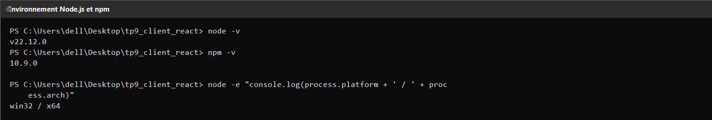

---

## 2. Configuration de l'accès à l'API

Un seul fichier rassemble les adresses utilisées par l'application : le préfixe de l'API,
les chemins des comptes et des statistiques, et la liste des types proposés dans les
formulaires. Changer de serveur ne demande donc qu'une modification à cet endroit.

Aucune adresse n'est écrite en dur dans les composants : chaque appel part d'une instance
unique configurée avec ce préfixe, un délai maximal de dix secondes et une lecture des
erreurs qui transforme les réponses de Spring en messages lisibles.

---

## 3. Vue d'ensemble de l'application

La page ouverte dans le navigateur montre les quatre indicateurs, le formulaire
d'ouverture, la barre de filtres et le tableau des comptes chargés depuis l'API. Les cinq
comptes de démonstration sont présents dès le chargement.

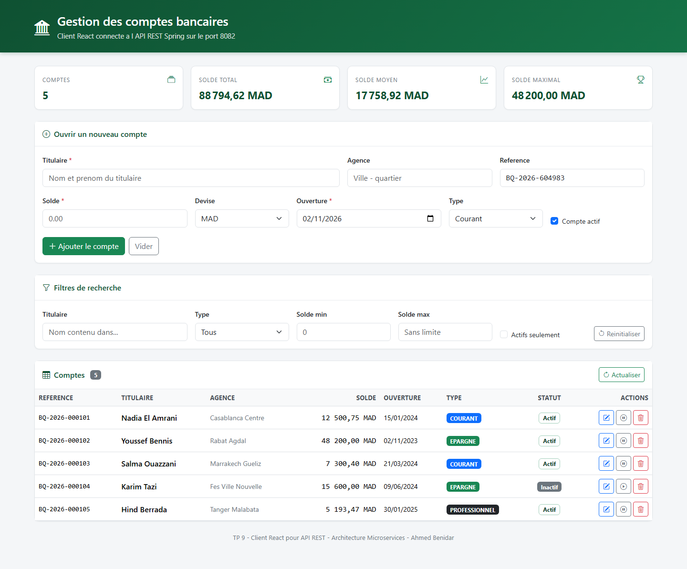

---

## 4. Indicateurs de synthèse

Les quatre cartes sont alimentées par le point d'entrée des statistiques. Le nombre de
comptes, le solde total, le solde moyen et le solde maximal sont calculés par le serveur,
pas par le navigateur : l'interface ne fait que les mettre en forme.

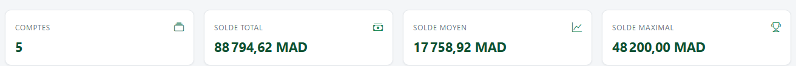

---

## 5. Filtrage de la liste

Les filtres ne sont pas appliqués en mémoire : chaque changement déclenche un nouvel appel
à l'API, avec un court délai pour ne pas envoyer une requête à chaque frappe. La capture
montre la liste réduite aux seuls comptes d'épargne, le compteur du tableau passant de
cinq à deux.

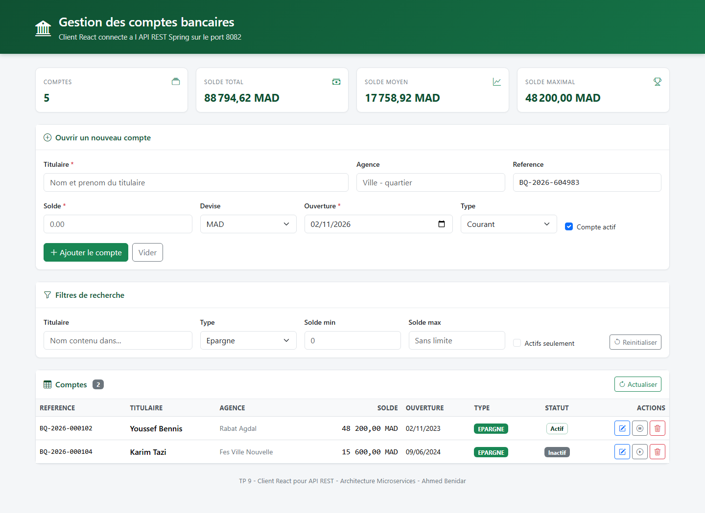

---

## 6. Ouverture d'un compte

Le formulaire est rempli comme le ferait un utilisateur. La référence et la date du jour
sont proposées automatiquement à l'ouverture, la devise et le type se choisissent dans des
listes, et les champs obligatoires sont vérifiés avant l'envoi.

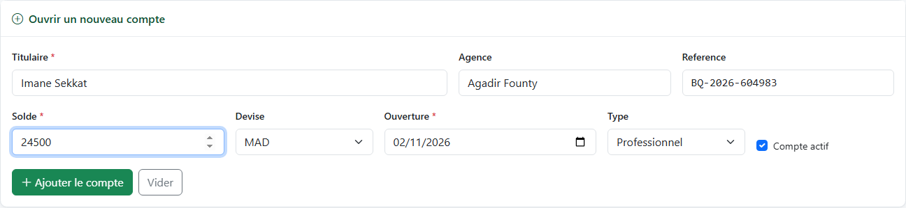

L'envoi réel aboutit : le bandeau de confirmation reprend la référence attribuée et
l'identifiant renvoyé par le serveur, et le tableau passe de cinq à six lignes.

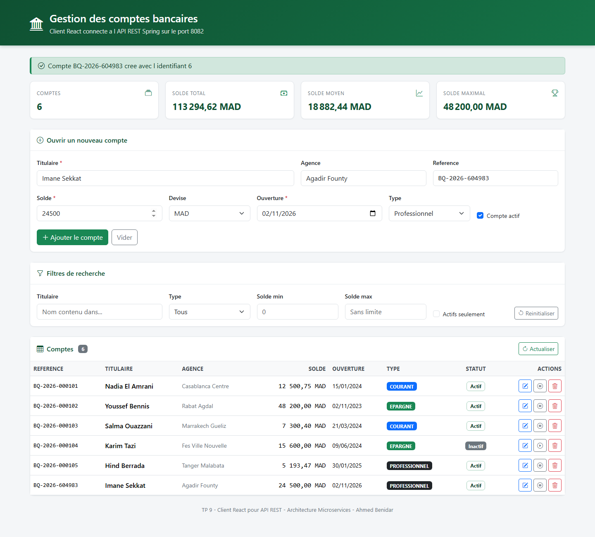

---

## 7. Modification d'un compte

Le bouton de modification recharge la ligne dans le formulaire, dont le titre change et
dont la référence devient non modifiable. Après validation, le nouveau solde apparaît dans
le tableau.

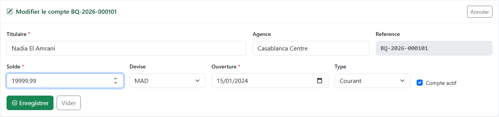

---

## 8. Changement de statut et suppression

Le bouton de statut bascule un compte entre actif et inactif sans passer par le formulaire.
Ici le compte de Karim Tazi, initialement inactif, est réactivé et la ligne repasse en
vert.

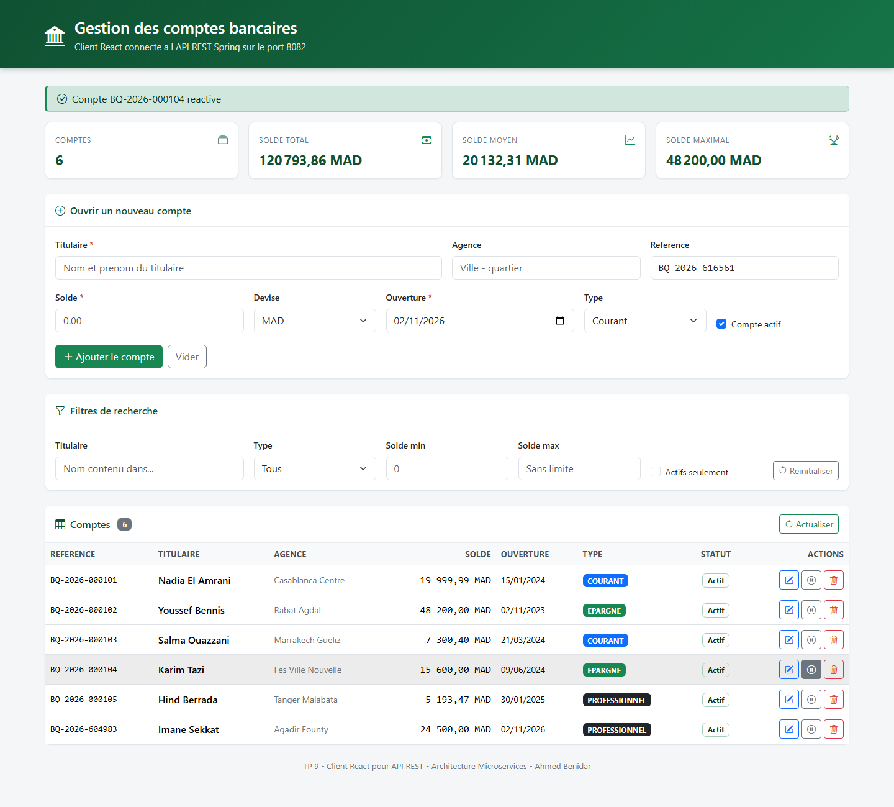

La suppression demande une confirmation, puis retire la ligne du tableau une fois la
réponse du serveur reçue. Le compte de Hind Berrada disparaît et le total se met à jour.

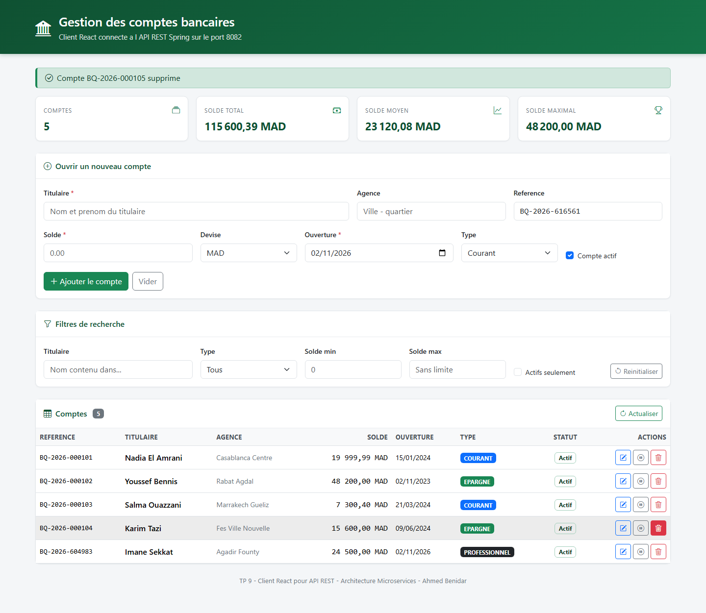

---

## 9. Preuve des appels réseau

Les requêtes émises par la page ont été rejouées depuis le terminal pour garder une trace
exploitable : lecture de la liste, lecture des statistiques, filtre sur le type, et un
identifiant inexistant qui renvoie bien un code 404 accompagné du corps d'erreur produit
par Spring.

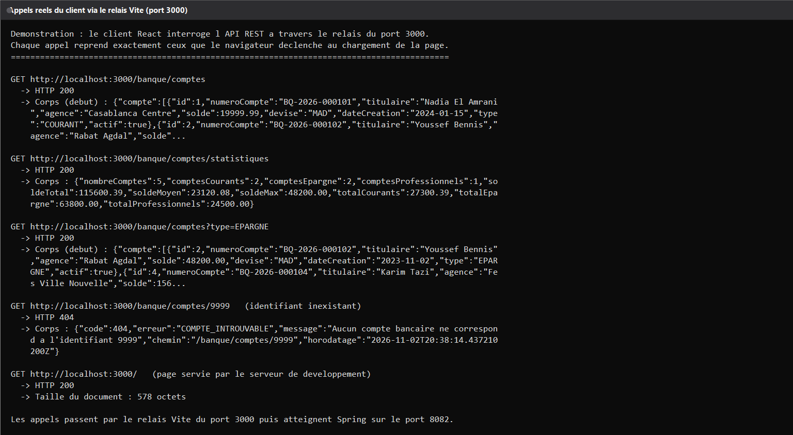

---

## 10. Build de production

Le projet se compile sans erreur avec la commande de build. Le rapport indique le nombre de
modules transformés et la taille des fichiers produits.

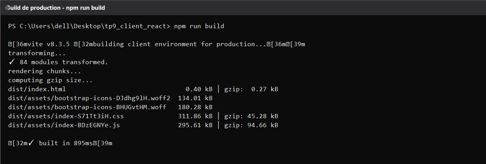
